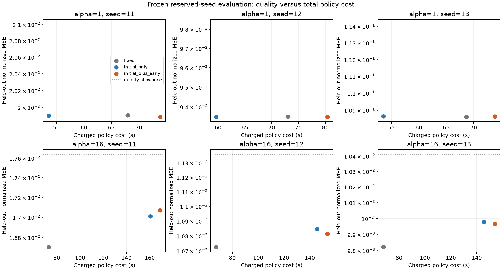

# DynamicsBench: validation-backed simulation decisions

Technical report · original study 2026-10-11 · public package 0.1.0

## Abstract

DynamicsBench audits deterministic differentiable simulations using observation-state and named parameter-gradient comparisons against a caller-supplied reference. Passing solver configurations are ranked by measured complete forward/backward cost, then checked at held-out snapshots. The shared Python/CLI workflow exports checks, rankings, scoped recommendations and provenance.

A frozen study of one nonlinear trajectory-learning task compares fixed RK4, post-warm-start initialization-only selection, and initialization-plus-early selection over two frequency regimes and three paired seeds each. Initialization-only selection saves 18.35–22.01% total charged policy time in the lower-frequency regime with similar held-out quality. In the higher-frequency regime, selected configurations improve sampled numerical fidelity but cost2.14–2.31× fixed settings without improving held-out prediction quality. The added early checkpoint provides no incremental useful decision under the frozen criterion. Numerical reliability and useful training decisions must therefore be assessed separately.

Independent engineering evidence includes an openly licensed neural-ODE workload, clean CPU installation, an installed GPU profile and one external Windows supplied-example usability attempt followed by repairs and a successful retest. The public package is MIT licensed; historical measurements retain their original version/environment scope.

## 1. System and intended use

The intended practitioner has a differentiable dynamics function, explicit named model parameters, a scalar objective and a defensible reference. The tool supports Euler and RK4 on CPU/CUDA with float32/float64 snapshots. It produces evidence for a finite set of configurations and snapshots, rather than a guarantee about future training or physical validity.

The processing path is: workload factory → owned snapshots → differentiable reference → candidate trajectory/gradient checks → eligible timing/ranking → held-out audit → exports. `core.py` provides numerical evaluation; `workflow.py` and `cli.py` share workload loading and exports. `execution.py` provides a separate eager/compiled comparison path. The default product CLI uses eager execution.

Snapshots detach and clone initial states and explicitly named tensor parameters. Every execution receives fresh parameter tensors with gradients enabled. A native nn.Module adapter uses strict torch.func.functional_call so supplied snapshots control the computation. Hidden trainable closure state, stochastic layers and mutable buffers require additional handling outside the verified deterministic contract.

One observation returns a terminal tensor with the initial state's shape. Multiple observations return a stacked tensor on an equally spaced grid excluding t=0; candidate steps must divide evenly by observation count. The objective callback is shared across cases. Case-specific targets require an explicit binding design or separate evaluations. The caller is responsible for reference credibility and for preserving parameter differentiation through it.

## 2. Numerical and measurement contracts

For each observation state and each named parameter group, L2 error must be at most `atol + rtol × reference L2 norm`. Default state tolerances are 1e-6 absolute/1e-3 relative; gradient tolerances are 1e-7 absolute/1e-2 relative. Relative error and cosine agreement are diagnostics. Near-zero reference groups retain absolute thresholds and report undefined relative/direction metrics as null. Unused parameters receive zero gradients. Every selection case must pass. Runtime/numerical candidate failures remain visible.

Only passing candidates are timed. Product execution timing includes fresh snapshot construction and complete forward/backward, two warmups and at least three repeats. CUDA wall time is synchronized. Samples/minimum/maximum/median are retained; overlapping observed ranges make ranks uncertain. GPU memory records allocated tensors, not total process/device consumption. Workflow elapsed time additionally includes reference and validation work, excluding factory setup and exports.

Held-out cases do not influence selection. `heldout_failed` means failure on a recorded held-out case at its declared thresholds; inspect the failed metric, callback and reference before choosing a remedy. `no_recommendation` means no tested candidate passed. Invalid observation grids, nonfinite behavior and callback failures can matter as well as step size. Reference/setup failures can instead abort evaluation. No sampled pass certifies unobserved checkpoints.

Exports comprise report.json, rankings.csv, recommendation.json, provenance.json and environment-lock.txt. Recommendations include tested snapshots, identities, tolerances, environment, source hashes and uncertainty. Source paths default to relative labels or opaque external-file identifiers; absolute paths require opt-in. Raw hashes identify exact bytes; canonical hashes normalize only UTF-8 CRLF to LF. These records do not automatically capture every import, dataset, closure, native library or reference justification. Caller metadata, error text and tensor snapshots still require review before sharing.

## 3. Correctness evidence

A targeted nonlinear audit examined `z′ = −z + tanh(zW + forcing cos(t))`, horizon4 and eight observation times, at two feedback strengths. RK4 refinement passed intermediate states and gradients. Eighteen finite-difference directional checks per device passed across three directions and three perturbation sizes. An analytical `z′=t` case checked preservation of global time offsets. This is sampled discrete-autodiff/refinement evidence, not verification of all continuous sensitivities or training states. The full audit records remain in the private archive; this public report summarizes that evidence.

The independently sourced workload uses the MIT-licensed [torchdiffeq neural-ODE example at pinned commit657943acefa826ef04c025ebeb1ff5e9d60dc268](https://github.com/rtqichen/torchdiffeq/blob/657943acefa826ef04c025ebeb1ff5e9d60dc268/examples/ode_demo.py). Its ODEFunc class is unchanged and its L1 objective expression retained. The adapter binds explicit weights, creates deterministic batches from the upstream cubic teacher, uses float64 and restores the t=0 objective term. Adaptive DOPRI 5 reference trajectories and parameter gradients were checked under tighter tolerances in P1. The second snapshot is a weight perturbation, not a trained checkpoint. Euler9 passes this short-window example; this is integration evidence, not evidence about long-horizon training.

## 4. Frozen empirical design

The question is whether checkpoint-aware validation improves training decisions after charging validation cost. The protocol was frozen before reserved-seed data generation. Freeze SHA256: `22ab74d94203770a59d2e2a812e67b79ea076755aaf167a4349d5b10a6281839`. Protected scientific inputs and original results remain separate from later product code.

Teacher: q′=v; v′=−alpha q−q³−0.15v. Alpha1/16, horizon6 and 16 observation times. The model retains q′=v and learns acceleration through a2→32→32→1 tanh MLP. Each seed11/12/13 uses32 training,8 calibration and 64 held-out initial conditions; splits and initialization are paired across strategies. State normalization uses training trajectories only. Teacher targets use float64 RK4/1024 checked against2048.

All policies share100 short-window warm-start Adam updates at learning rate0.003, followed by200 full-horizon updates. Both parameters and optimizer state are cloned. Initialization means post-warm-start, not random initialization. Strategy order rotates across seeds.

- Fixed uses RK4/64 for 200 full-horizon updates.
- Initialization-only selects at the post-warm-start snapshot, then trains200 updates.
- Initialization-plus-early runs20 updates with RK4/64, selects against initial and update20 snapshots, then trains180 updates with the selected configuration.

Candidates are Euler32/64 and RK4 16/32/64/128/256. Calibration references use RK4/512, with per-observation state and per-group gradient thresholds above. Selection uses the lowest median among passing candidates, with two warmups/three repeats. Explicit RK4/256 fallback is recorded if selection fails; no fallback occurred in evaluation.

Initial/update20/100/200 references are checked 512vs1024 at tighter thresholds. Final held-out normalized MSE uses common RK4/512 for all models, with state-reference refinement. Late checks are diagnostic and do not retune policies. A useful decision requires valid references, LOWER total policy time than paired fixed, and MSE ≤ fixedMSE×1.05+0.0001. Late numerical violations are reported separately.

Primary cost includes the warm-start charged to each standalone policy, cloning, training and complete selection work. Teacher generation, research-only snapshots/audits, late checks, held-out evaluation, serialization, queue delay and module startup are outside that policy cost. Shared warm-start is executed once but charged per policy; charged policy totals differ from actual study compute. Exact settings and accounting are in [the frozen protocol](research-replay/research/FINAL_PROTOCOL.md).

## 5. Reserved-seed findings

| Alpha | Seed | Strategy | Solver | Total policy s | Held-out normalized MSE | Late checks | Useful |
|---|---|---|---|---:|---:|---|---|
| 1 | 11 | fixed | rk4/64 | 67.98 | 0.01990892 | Pass | No |
| 1 | 11 | initial_only | rk4/32 | 53.59 | 0.01990460 | Pass | Yes |
| 1 | 11 | initial_plus_early | rk4/32 | 73.88 | 0.01988896 | Pass | No |
| 1 | 12 | fixed | rk4/64 | 73.04 | 0.09350319 | Pass | No |
| 1 | 12 | initial_only | rk4/32 | 59.64 | 0.09349466 | Pass | Yes |
| 1 | 12 | initial_plus_early | rk4/32 | 80.39 | 0.09349215 | Pass | No |
| 1 | 13 | fixed | rk4/64 | 68.67 | 0.10861099 | Pass | No |
| 1 | 13 | initial_only | rk4/32 | 53.56 | 0.10864730 | Pass | Yes |
| 1 | 13 | initial_plus_early | rk4/32 | 73.85 | 0.10863942 | Pass | No |
| 16 | 11 | fixed | rk4/64 | 73.05 | 0.01670529 | Fail | No |
| 16 | 11 | initial_only | rk4/128 | 160.52 | 0.01701101 | Pass | No |
| 16 | 11 | initial_plus_early | rk4/128 | 168.90 | 0.01707157 | Pass | No |
| 16 | 12 | fixed | rk4/64 | 67.39 | 0.01072478 | Fail | No |
| 16 | 12 | initial_only | rk4/128 | 145.65 | 0.01084604 | Pass | No |
| 16 | 12 | initial_plus_early | rk4/128 | 153.71 | 0.01081395 | Pass | No |
| 16 | 13 | fixed | rk4/64 | 67.98 | 0.00982093 | Fail | No |
| 16 | 13 | initial_only | rk4/128 | 145.58 | 0.00997895 | Pass | No |
| 16 | 13 | initial_plus_early | rk4/128 | 153.96 | 0.00996515 | Pass | No |

Initialization-only selects RK4/32 for all alpha1 cases, saving 18.35–22.01%. Its MSE ratios to fixed are 0.99978,0.99991 and 1.00033. It meets the useful criterion 3/3 times. The early strategy selects the same configuration, costs 7.54–10.06% more than fixed, and is useful 0/3 times.

For alpha16, both policies select RK4/128. Initialization-only costs 2.14–2.20× fixed; early costs 2.26–2.31×. Selected-policy MSE is0.83–2.19% higher, within the quality allowance but without improvement. Both are useful 0/3 times. Fixed64 fails sampled late numerical checks in all three cases; selected128 passes the 100/200 checks. Across both regimes selected policies pass12/12 late checkpoint audits, with no sampled early-pass/late-failure event.

The early procedure also changes the optimization path through its first20 fixed-solver updates, so its quality differences cannot be attributed solely to validation. Results establish a fidelity–cost tradeoff and a bounded easier-regime benefit. They do not establish that checkpoint checks are generally unnecessary. Three paired seeds per regime support descriptive comparisons, not statistical significance claims.

All18 teacher split refinements,72 model snapshot reference checks and 18 final held-out refinements passed. All18 strategy runs completed; no seed replacement, tuning, reference-failure exclusion, fallback or result-improving repeat occurred. PACE V100 array6169518 completed six cases. Paired strategies ran sequentially per case, with up to four cases concurrently; cluster contention was not fully isolated. Eager float64 training was used. These are bounded synchronized wall-time measurements, not a repeated performance study or GPU-utilization/energy measurement.

## 6. Separate GPU compilation evidence

An analytical diagonal-linear workload uses width 128, batch 32/512 and RK4/8. Eager and torch.compile(fullgraph=True) execution perform the same fresh-snapshot forward/backward and pass independent state/gradient checks. The within-job paired measurement uses three warmups,11 alternating-order repeats and synchronized timing on V100.

| Batch | Dtype | Eager ms | Compiled ms | Speedup | Compiled first call s | Estimated calls to amortize |
|---|---|---:|---:|---:|---:|---:|
| 32 | float32 | 6.053 | 0.822 | 7.37× | 16.128 | 3076 |
| 32 | float64 | 6.066 | 0.814 | 7.45× | 12.633 | 2405 |
| 512 | float32 | 6.086 | 1.159 | 5.25× | 12.091 | 2453 |
| 512 | float64 | 6.117 | 1.297 | 4.72× | 12.567 | 2606 |

All eight backend/workload combinations pass. Timing ranges did not overlap within this run. First-call values may benefit from earlier tests and persistent caches; they are not guaranteed cold-cache compilation costs. Amortization estimates divide excess first-call cost by measured per-call savings and are workload-specific.

Compilation used slightly MORE incremental allocated memory: e.g. batch 512 float64 increased from20,450,304 to22,050,816 bytes. Profiler evidence showed compiler-generated Triton fusion and fewer launches. No memory benefit or hand-written kernel contribution is claimed. These4.72–7.45× steady-state speedups apply to the analytical fixed-shape workload; the frozen training-policy study was eager and has no compiled training speedup claim.

Historical container: Python 3.10.12, Torch 2.1.0a0+32f93b1, CUDA runtime12.2 on V100, with source mounting. Failed Triton driver-discovery attempts and a job-local repair are retained. Current product installation profiles are separate.

## 7. Product installation and external usability

P2 verified a clean noneditable CPU installation and an installed wheel on A40 under PACE module25.10: Python 3.12.3/Torch 2.9.0a0+145a3a7bda.nv25.10/CUDA13.0. All36 tests passed after job-local Triton driver discovery repair. That module cannot execute on V100 capability7.0; it supports capability7.5 and above. Historical Python 3.10/Torch 2.1 source execution does not satisfy current package installation requirements.

Rc2 fixes were verified in a fresh uv environment without pip, with 19 CPU tests passing and 3 CUDA skips. Independent numerical checks match rc1. The declared minimums are Python 3.11, Torch 2.2 and NumPy 1.26; not every minimum-version combination has been exercised. Existing GPU compatibility evidence is rc1-scoped; rc2 changes provenance/CLI behavior rather than solver algorithms, but was not freshly GPU-benchmarked.

One external Windows CPU tester completed supplied-workload Task A, reported friction and retested rc2. First-run setup/syntax was assisted by AI. Retest installation/execution required no assistance; AI formatted feedback and reviewed JSON keys. The final pristine verifier confirmed 33 packet files, with 21 line-ending-only matches. Source paths were portable, all candidates passed and the held-out result passed. The retest resolved installation/path/provenance friction; interpretation is documented with its AI assistance.

P3 is closed for this bounded supplied-example usability deliverable. Task B was not attempted: independent human custom-model integration remains untested. This is one repaired usability attempt, not a controlled UX study. Unredacted tester histories stay in the owner's private archive, not the curated usability record.

## 8. Practical limits and further work

The study covers one model/task, two frequencies, three seeds, one warm-start curriculum and fixed thresholds/candidates. Sparse snapshots can miss transient violations. Relative gradient diagnostics can become unstable near zero; absolute thresholds matter. Refinement supplies credibility evidence, not exact ground truth. Numerical agreement with a software reference does not establish physical correctness, stiffness robustness, generalization or useful optimization.

The current eager implementation can be dominated by Python/kernel-launch overhead on small workloads. Timing ranks can change across machines/load, and compiler startup can outweigh steady-state benefits. No energy, analog-hardware, IC, large-model throughput or training-convergence claim is supported. CUDA allocated memory is not total device memory.

Engineering follow-ups include a second human custom-workload integration attempt and broader version-profile checks when needed. Optional budget-aware checkpoint selection remains a separately scoped research idea; it needs related-work review and a new protocol. It is not implemented or inferred successful from this study.

## 9. Reproduction and release contents

[QUICKSTART.md](QUICKSTART.md) covers installation and examples.
[REPRODUCING.md](REPRODUCING.md) separates current product checks from historical replay.
[EVIDENCE_INDEX.md](EVIDENCE_INDEX.md) maps the public evidence and identifies path-label
redaction. RELEASE_MANIFEST.json verifies the public payload. Private operational logs
and tester correspondence are excluded. Frozen tensors are trusted owner-generated
snapshots; do not load untrusted pickle files. Original code is MIT licensed and the
upstream example license is retained in THIRD_PARTY_NOTICES.md.
